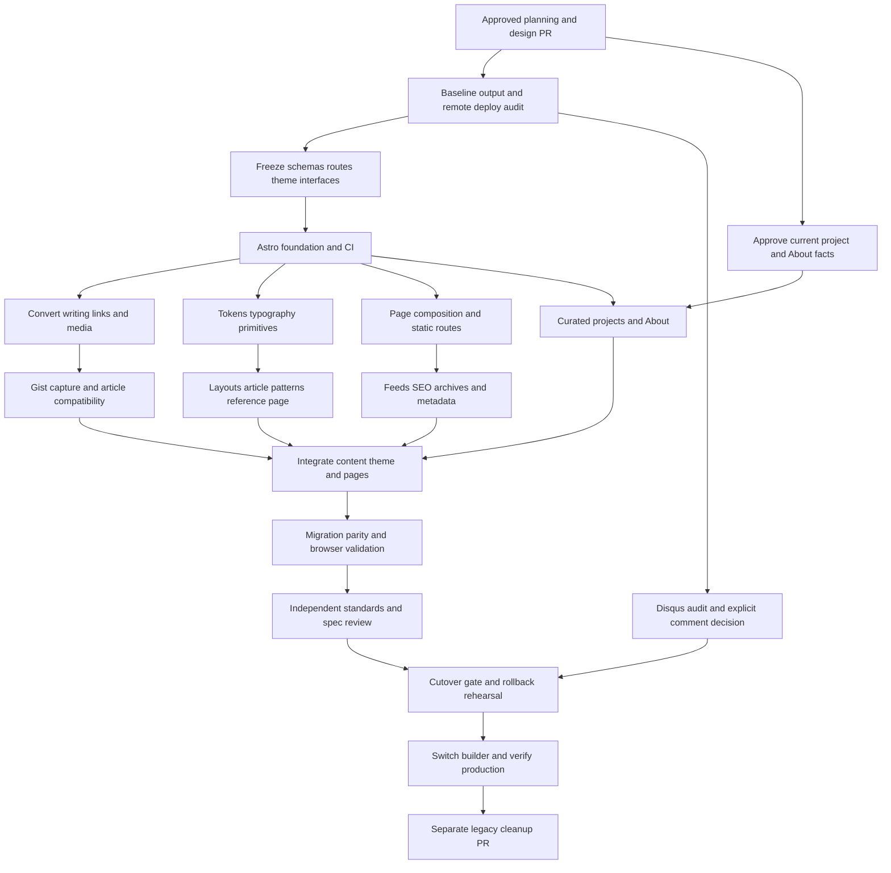

# Astro migration implementation plan

## Status and scope

This is the implementation plan for migrating Ajat Prabha's personal site from Jekyll to Astro.
Implementation starts after the planning and design PR has been reviewed.
The planning PR does not change the live site, build workflow, or publishing toolchain.

The repository is `/home/ap/workspace/ajatprabha/ajatprabha.github.io`.
The source branch remains `blog`, and the existing workflow publishes Jekyll output from `.build` to `gh-pages`.
Remote Pages configuration was verified on 10 October 2026: build type `legacy`, source branch `gh-pages`, path `/`, and custom domain `https://ajatprabha.in`.
The inspected source commit is `05df188c31df1c4b1692872fb69ad28e701c6fc7`, and the published branch commit is `1d98a4360478f467a2dd2427418f295c059986ba`.
Recapture these commit references and the deployed artifact at implementation start because publication can change after planning.
The proposed migration preserves these Pages settings and requires no repository setting mutation.

Read these inputs before starting:

- `docs/research/migration-inventory.md`: verified local inventory, migration risks, and remaining evidence gaps.
- `docs/README.md`: selected framework, authoring, hosting and theme ownership decisions.
- `docs/design/field-journal-theme.md`: exact visual tokens, typography, layout, interaction choices, and approval status.
- `docs/design/launch-decisions.md`: finalized feature scope, project ordering, resume-derived biography, and remaining preservation work.
- `_config.yml`, `.github/workflows/build.yaml`, `_posts/`, `about/index.md`, `_plugins/`, and the legacy layouts: current behavior.
- Applicable `AGENTS.md` instructions and the GitHub operating skill before performing GitHub actions.

### Locked decisions

| Decision | Approved direction |
| --- | --- |
| Framework | Astro with static output |
| Publishing | Markdown committed to Git |
| Hosting | GitHub Pages with the existing custom domain |
| Theme | One compact, owned theme with documented interfaces |
| Architecture | Composability across presentation, content, routing, integrations, and tooling |
| Identity | Engineering field journal |
| Homepage emphasis | Balanced writing and projects |
| Delivery | Planning/design PR first, implementation afterward as a reviewed stack |

Colors and typography belong to the approved new design system.
Do not carry over the old theme's palette or fonts merely because they already exist.
Do not introduce independently styled AI-generated sections or a separate component system for each page.

### Selected launch scope, defaults, and verification gates

The user settled feature scope and first-draft visual choices on 12 October 2026.
The launch decision record distinguishes those choices from architecture defaults and remaining implementation evidence.

| Area | Proposed default | Gate |
| --- | --- | --- |
| Historical article URLs | Keep exact existing dated URLs as canonical | Validate actual Jekyll output and production behavior |
| New article URLs | Use the same dated convention | Confirm during contract freeze |
| Theme modes, fonts, palette, motion | Palette, fonts, and light/dark selected for first draft; motion follows specification | Verify implementation against selected design |
| Search | None at initial launch | Selected |
| Newsletter | RSS only; no signup service | Selected |
| Analytics | None at initial launch | Selected; do not copy obsolete Universal Analytics |
| Comments | No public comments; preserve an archive if any existing comments exist | Audit actual threads and archive before cutover |
| External code embeds | Local syntax-highlighted blocks with source links and attribution | Selected; capture and compare available Gist files |
| Projects | Darkroom, Tempogate, Ferry, Dagger, xrun, GSoC Kubernetes Dashboard work, in that order | Selection and authorship supplied by user; verify technical descriptions |
| About | Resume-sourced, role-neutral biography as recorded in launch decisions | Explicitly selected; do not infer a present role from ended positions |
| App location | Permanent `site/` directory | Architecture default, chosen to support safe coexistence |
| Deployment | Keep branch-based `gh-pages` publishing for this migration | Verify existing Pages settings before implementation |

Feature decisions are settled; actual comment preservation and source/content parity remain cutover gates.
All 23 referenced Gist files were available in the follow-up audit, but code capture is still required.
The sourced biography and six selected projects are enough for the first preview; no biography decision remains.

## Repository architecture

Keep the Astro app in `site/` permanently.
The current Jekyll source remains intact during implementation, and `_config.yml` explicitly excludes `site/`, migration validation fixtures, and review artifacts from Jekyll output.
The only production-affecting foundation change should be these deliberate exclusions, verified against the legacy build.

Use native Astro components and ordinary CSS by default.
Use framework integrations for content, code highlighting, feeds, sitemap generation, and assets when their interfaces fit the selected version.
Add browser JavaScript only for approved interactions such as the mode toggle.
Search is excluded from initial launch.
An application framework, client router, UI kit, animation library, or MDX integration requires a concrete selected use case.

Proposed source boundaries:

```text
site/
  package.json
  <generated package-manager lockfile>
  astro.config.mjs
  tsconfig.json
  public/
    CNAME                       # prepared from the root source during build
    assets -> ../../assets      # ignored, prepared locally when supported
  src/
    content.config.ts           # version-appropriate Astro collection configuration
    content/
      writing/*.md
      projects/*.md
    data/
      site.ts
      navigation.ts
      featured.ts
    lib/
      content.ts
      routes.ts
      compatibility.ts
    theme/
      tokens.css
      base.css
      article.css
      components/*.astro
      layouts/*.astro
      README.md
    pages/
      index.astro
      writing/
      projects/
      about.astro
      tag/
      author/
      [...legacy].astro
      feed.xml.ts
      atom.xml.ts
      404.astro
  scripts/
    prepare-public.mjs
    validate-content.mjs
    validate-output.mjs
    validate-feeds.mjs
  tests/
    migration/
    browser/
docs/
  migration/
    baseline/                   # small generated evidence, generated by commands only
    decisions.md
  publishing.md
  rollback.md
```

Exact filenames may follow the selected Astro version's conventions.
Preserve these responsibilities and interfaces if those conventions differ.
Do not manually edit generated lockfiles, baseline output, or generated assets.

### Media and domain handling

The existing media inventory is 63 images and five videos, approximately 59 MiB in total.
Keep `assets/` as the single tracked source of legacy media and retain exact public URLs, including spaces and filename case.
Do not duplicate this media tree into the new app's tracked files.

The coordinator owns a preparation script that exposes root `assets/` as `site/public/assets` through an ignored relative symlink when the build tool supports it.
Verify symlink handling with the actual pinned Astro/Vite versions in local development and CI.
If unsupported, use an ignored build-time copy or explicitly copy the existing media into `site/dist/assets` after Astro builds, with the matching local development strategy documented.
Copying into generated output is expected and does not duplicate tracked source.
The preparation step must fail visibly on missing inputs and must not delete the root media source.

Prepare `CNAME` from the root file and verify it exists in the published artifact.
Legacy media stays at `/assets/...`; new theme assets and optimized thumbnails can use Astro's asset pipeline without changing historical media references.
Preserve native video controls, responsive portrait and landscape presentation, and conservative preload behavior.

## Contracts to freeze before parallel implementation

Task F02 produces the shared interfaces below, with small example fixtures and minimal working components.
All agents must use these interfaces until the coordinator deliberately versions a change.
An agent proposing a contract change sends the affected schema, callers, and migration impact to the coordinator before editing shared files.

### Content schemas

Use Astro's version-appropriate content collection APIs with schema validation.
Dates must not drift through implicit parsing or timezone conversions.
Capture legacy publication timestamps from real generated metadata or feeds and retain the source date interpretation in the baseline manifest.
Do not invent an offset for an ambiguous source date.

Proposed writing front matter:

```yaml
title: "Article title"
description: "A factual summary used by previews and metadata."
publishedAt: "<verified ISO timestamp including offset>"
route: "/YYYY/MM/DD/exact-legacy-slug"
tags: [golang]
author: ajatprabha
cover:
  src: "/assets/images/existing-cover.jpg"
  alt: "A description of the image."
draft: false
# Optional: updatedAt, featured, projectIds, legacySourceId
```

`route` is explicit for migrated articles and must match the baseline manifest.
The importer must not derive it from a display title.
The xrun file is named `2023-05-25-...`, while its front matter date is May 24, demonstrating why filename-only date logic is unsafe.
The baseline build determines the actual canonical path.
Schema validation rejects duplicate routes, invalid dates, unknown project references, and invalid local media paths.

Proposed project front matter:

```yaml
title: "Project name"
description: "Verified one-sentence description."
status: active
tags: [golang]
links:
  source: "https://github.com/..."
# Optional: website, documentation, cover, featured, startedAt, updatedAt
```

Project IDs come from stable collection entry names, and project routes are `/projects/<id>/`.
Choose a small documented status vocabulary during F02, such as `active`, `maintained`, `archived`, and `completed`.
Do not require numeric metrics, dates, or impact claims that have not been verified.
Project body Markdown explains purpose, decisions, and relevant work; writing can reference project IDs without duplicating project descriptions in templates.

Keep author identity, social links, navigation, and feature ordering in typed site data.
New writing and project publishing should normally require content and metadata edits only.

### Routing and compatibility

The coordinator owns these conceptual interfaces:

```ts
getWriting(): Promise<WritingEntry[]>;
getProjects(): Promise<ProjectEntry[]>;
articlePath(entry: WritingEntry): string;
projectPath(id: string): string;
tagPath(tag: string): string;
canonicalUrl(path: string): string;
legacyRoutes(): LegacyRouteRecord[];
```

Freeze the actual types with the chosen Astro version rather than copying assumed collection types from an old template.
Sort writing deterministically by verified publication time and stable ID.
Do not let layout components rebuild route slugs or parse timestamps independently.

Preserve exact legacy post URLs, tag slug mappings, author routes, reachable home/archive pagination, and feed endpoints.
New `/writing/` and `/projects/` routes may coexist with compatibility archives.
The manifest distinguishes canonical articles, compatibility archive pages, and confirmed pre-existing broken links.
If route aliases are approved, generate actual static alias pages compatible with GitHub Pages; do not assume framework redirect configuration provides server-side redirects on this host.

Capture historical heading IDs and maintain important fragment targets when Markdown parsers differ.
Prefer deterministic build-time anchor compatibility over browser script repair.
Validate cross-article links and fragments against generated HTML.

Maintain both `/feed.xml` and `/atom.xml`, including their historical item identity semantics.
`atom.xml` currently contains RSS despite its filename; preserve subscriber behavior rather than guessing a replacement format.
Do not blindly merge the two endpoint identities into one newly generated feed.

### Theme interfaces

The approved design specification defines semantic tokens for surfaces, text, accents, borders, focus, typography, spacing, reading widths, radii, and motion.
Freeze these token names before theme and page agents work independently.
Use tokens for both modes if dual-mode presentation is selected.

Minimum shared components and layouts:

| Interface | Responsibility |
| --- | --- |
| `SiteShell` | Document shell, metadata integration, skip link, navigation and footer |
| `HomeLayout` | Balanced intro, selected projects, recent writing and personal note |
| `ArticleLayout` | Title, publication metadata, cover, reading column, content and related links |
| `IndexLayout` | Shared page introduction, list/grid widths and pagination |
| `ProjectLayout` | Project identity, verified links, status and Markdown body |
| `ContentEntry` | Normalized article/project summaries with `article-row`, `project-card` and `featured` variants |
| `ProjectPreview` | Normalized preview metadata with `diagram`, `image` and `none` variants |
| `TagLink`, metadata presentation, pagination | Reusable content navigation using the same theme tokens |
| Article styles | Code, tables, figures, galleries, callouts, native media and headings |

Use the complete component and variant contracts from `docs/design/field-journal-theme.md` rather than treating this minimum list as a second API.
Freeze documented named slots and normalized child-piece inputs alongside data types in F02.
The listed layouts provide structural regions, while routes compose entry lists and optional controls into those regions.
The `ContentEntry` inventory may be implemented as explicit article-row and project-card modules sharing primitives; do not force structurally distinct content into one switch-heavy module.
Route adapters normalize collection entries into summary/view props before invoking theme components.
Do not pass raw collection entries, arbitrary front matter, open-ended style props or collection-loading functions into the theme.
Page composition controls which records appear and in what order.
Theme components control their presentation.
Business/content selection belongs in `src/lib/` and typed site data, not CSS or layout-specific copies of collection queries.

Expose a theme reference page during development that shows every implemented variant, focus state, article content pattern, and approved color mode.
Exclude this page from production output unless deliberately approved for publication.
Document how to add variants, update tokens, publish content, and perform dependency upgrades.

### Composability across the project

Apply the composition requirements in the theme specification to every implementation agent's owned area.
Content importers compose deterministic transformations with filesystem and network access handled by entry-point adapters.
Routes, feeds, and sitemap adapters reuse the same normalized content and canonical helpers.
Pages assemble focused pieces through layout slots instead of growing layout flags or duplicating page-specific systems.
Interactions own state locally unless real coordination requires a shared owner; static composition must not require React or client hydration.
Asset preparation, output validation, and CI reuse focused modules and the same command entry points rather than parallel implementations.
Use explicit interfaces and imports, with replaceable adapters for actual variation; avoid speculative registries, configurable mega-components, and wrappers that add no behavior.

F02's contract review includes named slots, permitted data/visual variants, and two representative compositions.
T02's reference fixtures and R01's pages must demonstrate reuse across real contexts and omission of optional regions without structural boolean props.
V02 reviews composability against those examples, including content/tooling seams, alongside visual consistency and migration fidelity.
Record this criterion in each implementation agent's handoff so parallel work preserves one compositional system.

## Executable task DAG

The DAG represents implementation dependencies.
The PR stack represents review and cumulative integration order.
They are deliberately different: content, theme, and page work can run from the same foundation contract while their completed changes are later stacked linearly.



### Task ownership and completion evidence

| ID | Owner | Owned files/areas | Completion evidence |
| --- | --- | --- | --- |
| F01 | Coordinator with content agent | Baseline capture commands, small evidence manifest, remote configuration record | Real legacy build; route/feed/heading/media manifest; exact deployed commit/artifact recorded |
| F02 | Coordinator | Schemas, route helpers, shared types, fixture examples, ownership ledger | Contracts reviewed and minimal fixtures validated |
| F03 | Coordinator | `site/package.json`, generated lockfile, Astro/TS config, asset preparation, CI, legacy exclusions, gated theme reference route | New fixture builds; legacy build still succeeds; scripts documented |
| C01 | Content agent | `site/src/content/writing/`, conversion code, content-specific fixtures | All 13 posts imported with exact routes/dates; nine Liquid references resolved; Kramdown syntax removed or converted |
| C02 | Content agent | Local Gist captures, attribution, anchor/galleries mapping | Every referenced external code source audited; no missing intended article content; approved compatibility patterns used |
| C03 | Content agent | `site/src/content/projects/`, factual About content data | Approved projects and biography represented; project references validated |
| T01 | Theme agent | `site/src/theme/tokens.css`, `base.css`, primitives | Matches approved design; defined focus, contrast and responsive states |
| T02 | Theme agent | Theme layouts/components, article CSS, theme documentation and reference fixtures | Representative code/gallery/table/video patterns render consistently |
| R01 | Page agent | `site/src/pages/` except the coordinator-owned theme reference route; page-only composition helpers | Home/writing/projects/About/article navigation works with frozen fixture data |
| R02 | Page agent | Feed/SEO adapters, compatibility archives and routes | Canonicals, archive links and feed identities match contracts |
| X01 | Coordinator | Comment audit evidence and selected adapter contract | Actual Disqus thread mapping inspected; decision documented; selected behavior validated |
| I01 | Coordinator | Integration branch and shared contract fixes | Integrated build passes; no duplicate style or content systems |
| V01 | Coordinator with specialists | Output validation, browser journeys, fixes within original ownership | Route/content/feed/media/fragment parity and selected UI requirements pass |
| V02 | Two independent reviewers | Review reports only | Standards and approved specification reviewed; actionable findings resolved |
| V03 | Coordinator | Deploy workflow candidate, rollback guide and checks | Artifact contains domain/media/routes; rollback inputs usable; blockers closed |
| DEP01 | Coordinator | Existing workflow builder switch | Real production deployment checked on canonical host |
| CLEAN01 | Coordinator or mechanical cleanup agent | Obsolete Ruby/Gulp/Jekyll files and docs | Separate cleanup PR reviewed after production is verified |

The file boundaries are exclusive during parallel work.
The coordinator creates minimal theme interface implementations in F03 and explicitly transfers their ownership to the theme agent before T01.
The coordinator also creates `site/src/pages/theme-reference.astro`, gated to development or an explicit review build and absent from production output.
This route renders the theme-owned `site/src/theme/ReferenceFixtures.astro`, initially a minimal fixture and expanded by T02.
R01 must not edit the reserved route, and T02 must not create page routes.
The page agent consumes those interfaces and must not edit theme components.
The content agent owns Markdown transformations and must not solve rendering problems through page-specific inline styles.
Coordinator-owned package/configuration changes requested by specialists are serialized by the coordinator.

## Multi-agent execution and worktrees

Use at most four active agents: one coordinator and three implementation agents.
The coordinator handles contracts, integration, shared tooling, GitHub and validation gates.
The content, theme and page agents work concurrently once F03 is complete.

Create separate Git worktrees for worker branches from the exact foundation commit.
Record their absolute paths, base SHA, file ownership and commands in each agent's task.
Worker handoffs go to `/tmp/claude-handoffs/ajatprabha-blog-<topic>.md` and must stand alone with repository/worktree path, required reading, task IDs, constraints, ownership and verification instructions.
Do not have independent agents edit the shared checkout.

Example branch arrangement:

```text
blog
  migration/01-foundation
    worker/content
    worker/theme
    worker/pages

review stack after integration:
blog
  migration/01-foundation
    migration/02-content
      migration/03-theme
        migration/04-composition
          migration/05-cutover
            migration/06-cleanup
```

Worker branches are implementation inputs, not extra PR layers.
The coordinator cherry-picks or otherwise integrates reviewed worker commits in the selected linear order, then verifies each cumulative branch.
Do not ask workers to build on successively changing PR heads when their frozen foundation contracts are sufficient.

Use small integration checkpoints after C01, T01 and R01 to expose contract problems early.
These checkpoints may be temporary local integration branches, not additional public PRs.
When a lower layer changes, propagate the correction through dependent stack branches and rerun the affected checks.
Never mask a broken cumulative branch by testing only the top of the stack.

For independent review, finish or idle implementation agents and run two reviewers alongside the coordinator, keeping the four-slot limit.
The coordinator fixes findings; reviewers remain read-only unless a new scoped task is assigned.

The critical path is approved design -> baseline/contracts -> foundation -> slowest of content/theme/pages -> integration -> parity/review -> cutover.
Baseline capture, content fact collection and comment investigation can start together after planning approval.
Do not promise wall-clock estimates or claimed performance improvements before measuring the actual implementation.

## Linear implementation PR stack

The planning stack precedes implementation: `plan/astro-theme` targets `blog`, and `plan/astro-migration` targets `plan/astro-theme`.
The lower planning PR records theme and requirements; the upper planning PR records this execution plan.
Neither planning layer changes application or deployment behavior.
The following six layers are the proposed implementation sequence.
Layer six is intentionally deferred until layer five's production deployment has been verified.

| Layer | Branch/base | Contents | Required cumulative checks | Production behavior |
| --- | --- | --- | --- | --- |
| 1. Baseline and foundation | `migration/01-foundation` -> `blog` | Real baseline capture, schemas, minimal theme interfaces, static app/tooling, asset preparation, legacy exclusions, PR CI | Legacy Jekyll build; Astro fixture check/build; asset preparation and baseline integrity | Jekyll continues |
| 2. Content | `migration/02-content` -> layer 1 | All writing, current approved project/About facts, link/anchor conversion, Gist captures and compatibility manifest | Previous checks plus schema/source-content/media/reference validation | Jekyll continues |
| 3. Theme | `migration/03-theme` -> layer 2 | Approved tokens, typography, primitives, layouts, article patterns, reference page and theme guide | Previous checks plus representative theme rendering and selected interaction states | Jekyll continues |
| 4. Composition | `migration/04-composition` -> layer 3 | Finished routes, navigation, home/writing/projects/About, feeds, SEO, archives and selected features | Full output parity, feed/media/fragment checks and browser journeys | Jekyll continues |
| 5. Validation and cutover | `migration/05-cutover` -> layer 4 | Resolved reviews, deploy builder switch, publishing/rollback docs, final release gate | All checks; candidate production artifact verified; rollback rehearsal | Astro deploys when merged into `blog` |
| 6. Cleanup | `migration/06-cleanup` -> layer 5, then `blog` after predecessor merges | Remove obsolete legacy tooling/source that is no longer required; retain historical evidence and asset source | Astro checks/build/parity and production smoke check | Astro continues |

Open layers one through five as draft PRs when their concrete, reviewable changes exist.
Do not create empty implementation PRs just to reserve a stack.
Create layer six after production verification, or keep its prepared changes local until then.
Retarget each next PR to `blog` as predecessors merge and preserve a clean cumulative diff.
Include stack links and layer-specific validation in each PR description.

Use the GitHub operating skill and configured Git identity.
Do not add agent co-author trailers or override author/committer identity.
Register every created or worked-on PR with T3's `link_pull_request` tool when available, and reconcile the thread's registered PR list before finishing.

## Toolchain and planned commands

These are proposed script interfaces to implement in F03, not commands that currently exist.
At implementation time, verify the latest stable Astro version and required Node/package-manager versions from official documentation.
Pin the selected versions and generate the lockfile through the package manager.
Record the exact versions and any compatibility reason for choosing an earlier release.
Use one package manager and one supported Node version across local development and CI.

| Planned command | Responsibility |
| --- | --- |
| `npm --prefix site ci` | Reproducible dependency installation from the generated lockfile |
| `npm --prefix site run dev` | Prepare shared assets and serve the app locally |
| `npm --prefix site run check` | Astro/TypeScript diagnostics and focused lint rules |
| `npm --prefix site run validate:content` | Schema, route uniqueness, source parity, references and media |
| `npm --prefix site run build` | Prepare assets/domain, generate static output and finalize artifact assets |
| `npm --prefix site run validate:output` | Built HTML routes, canonicals, links, anchors, metadata and media |
| `npm --prefix site run validate:feeds` | Endpoint format, links, publication dates and historical item identities |
| `npm --prefix site run test:browser` | Targeted end-to-end journeys against a built preview server |
| `npm --prefix site run preview` | Serve the generated static artifact for review |
| Documented baseline command | Build legacy Jekyll in an isolated environment and generate evidence |

Ruby/Bundler is absent locally according to the inventory, while Docker is available.
Create a reproducible container-based legacy baseline command using the checked-in dependencies and a compatible Ruby version, or use an equivalently isolated documented environment.
Do not assume the current repository Dockerfile already provides the needed capture workflow.
If the current legacy build fails, reproduce and fix the relevant build problem before claiming a reliable baseline, preserving source content and URLs.

## CI and validation

### Workflow structure

Keep `.github/workflows/build.yaml` as the existing production workflow until layer five changes its builder.
Introduce a PR validation workflow in layer one.
Use `pull_request` events without a `branches: [blog]` restriction because stacked PRs target predecessor branches.
Avoid path filters that accidentally skip required checks on content-only, media-only, schema-only or documentation-related stack changes.
Keep stable check names and align repository required checks with the actual emitted jobs.

Production deployment remains a `push` to `blog`, not a pull request event.
Validate the PR's merge result as well as the expected cumulative branch contents where appropriate.
Run legacy and Astro validation while both systems coexist.
Use explicit stage-aware validation coverage: source migration checks can run in layer two, while full route/output parity becomes required once layer four supplies all routes.
Do not mark output parity passed when only fixture pages were built.

The final deployment builder installs pinned Node dependencies, performs the same check/build/parity commands as PR CI, and publishes `site/dist` through the existing branch publishing mechanism.
Verify the action configuration, permissions, custom domain, deployment serialization and Pages source settings against the actual repository.
Keep Ruby/Jekyll files and a documented restore workflow available until the separate cleanup layer.

### Meaningful checks

| Check | What it must prove |
| --- | --- |
| Content inventory | All 13 posts exist with preserved titles, publication dates, routes and substantive body content |
| Rich content | Code examples, Gist captures, raw HTML conversions, SVG diagrams, tables and video survive migration |
| Local references | Internal article links, selected project references, media paths and fragments resolve |
| Route compatibility | Historical articles, reachable tag/author/home pagination, About and both feeds remain reachable |
| Metadata | Canonical host/path, article metadata, sitemap and social previews are correct |
| Feed compatibility | Existing subscribers retain recognizable item identifiers and dates without duplicate historical entries |
| Accessibility | Keyboard navigation, visible focus, skip link, semantic landmarks, labels and selected mode contrast |
| Responsive behavior | No horizontal page overflow; code/tables contain their own overflow; portrait and landscape media fit |
| Progressive enhancement | Navigation and content work without JavaScript; reduced motion is respected |
| Composability | Shared pieces work in actual article/project contexts; optional regions are assembled or omitted; processing and checks reuse explicit modules without duplicate implementations |
| Artifact integrity | `CNAME`, all intended static routes, media and 404 are in the published directory |

Validate representative pages for Ferry, Windows Registry, Kubernetes Operator, week-two Gojek, TDD and DIY Sound System.
Include home, both primary indexes, a project detail, About, a compatibility archive and 404 in browser journeys.
Check narrow mobile and desktop layouts, selected color modes and keyboard operation.
Test the deployed host's actual slash behavior for historical article URLs instead of relying only on the local preview server.

For interactive review, use T3 collaborative preview tools when exposed, starting with `preview_status` and `preview_open` if necessary.
Automated browser checks may use a pinned test toolchain in CI, while interactive browser work follows the host's preview-tool requirements.

Record screenshots as review evidence when useful, without introducing snapshot churn as the primary acceptance test.
Do not regenerate baselines to conceal changed content or broken layouts.
Measure page size, client JavaScript and representative loading behavior after implementation; describe measured results without fabricated benchmarks.

### Legacy audit details

Generate the route manifest from actual Jekyll output and compare key routes with production.
Record heading IDs, feed item identifiers, metadata, internal references and media paths.
Do not assume sample `_data/tags.yml` entries describe the real tag taxonomy.
The real inventory contains 11 tags, and exact slug mappings must be retained.

Audit the 24 Gist occurrences across 23 distinct script URLs.
Retrieve the exact referenced files, record source attribution, compare their contents and preserve language/code formatting.
An unavailable Gist requires an archived source or an explicit content decision; a missing embed does not count as a successful conversion.

Inspect actual Disqus threads to determine whether a comment archive is required.
The existing configuration assigns the homepage URL and site title to every article's widget.
Do not generate new per-article identifiers and call that preservation.
The selected launch has no public comments or Disqus integration.
If comments exist, preserve an archive with original thread identifiers, known article mappings, and export provenance before cutover.
If export needs authenticated access, ask for the specific export or access after preparing concrete instructions.
Do not silently skip archival or publish the preservation archive without a separate request.

The `/gsoc-meta-k8s/` archive was verified live on 12 October 2026 despite its missing source in this checkout.
Preserve its reachable link and investigate its separate project publishing mechanism before changing branch output.
Do not delete the link or invent a replacement page based only on missing local source.

## Cutover and rollback

Before merging layer five, record the last known-good deployed `gh-pages` commit and preserve a usable copy of its static artifact.
Record the corresponding legacy source commit and confirm the documented legacy restore build works.
Do not rely on Actions artifact retention as the only rollback copy without verifying its availability.

Cutover checklist:

1. All approved design and feature requirements are represented in the integrated branch.
2. No unresolved missing Gist content, comment disposition, route parity or factual-content blocker remains.
3. The cumulative stack passes required CI and independent review.
4. The exact candidate static artifact is checked for domain, routes, feeds, metadata and media.
5. The Pages branch/source setting is confirmed, and the production workflow switch is reviewed.
6. The rollback artifact and legacy source workflow path are documented and usable.
7. Merge the cutover layer into `blog`, observe deployment completion and smoke-test the real custom domain.
8. Recheck representative old article URLs, both feeds, media/video, navigation, canonical tags and 404 on production.

Changing the source builder and deleting the legacy tooling must remain separate PRs.
Layer five keeps the legacy Ruby build available; layer six removes it only after production has been verified.

If production fails, stop or prevent further competing deployments while restoring the last known-good static artifact to `gh-pages` through the documented publishing mechanism.
Then revert only the production builder switch on `blog`, preserving the migration sources and review history.
The restored workflow must explicitly run the legacy builder; reverting an unrelated Astro component change does not restore a Jekyll deployment.
Verify the rollback on the canonical host and close the incident before attempting a new cutover.

After layer six, source rollback to Jekyll requires a separate restoration of removed legacy tooling from the recorded commit.
The known-good static artifact remains the immediate rollback option independent of that cleanup.

## Completion criteria

The migration is complete when the reviewed Astro artifact is live on `ajatprabha.in`, historical content and links retain the agreed compatibility, and the selected design works consistently across writing and projects.
Publishing a new article or project uses documented Markdown/front matter rather than template edits.
The theme's components, tokens and extension rules are documented and exercised by shared reference fixtures.
CI checks the actual static output and meaningful user journeys.
The implementation PR stack and any cleanup PR are linked to the thread, with clear validation evidence and remaining limitations.
Production verification and rollback evidence are recorded before removing legacy tooling.
